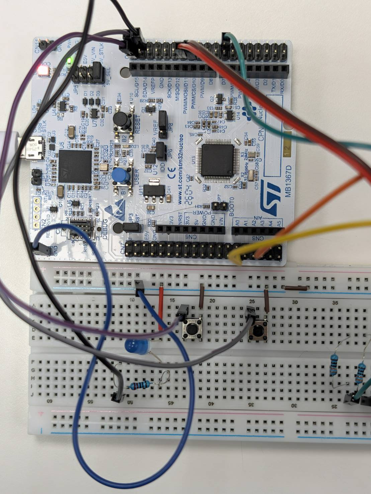

# 摩斯電碼雙向收發器 (NUCLEO-G474RE 期中專題)

透過實體電鍵解碼摩斯點劃，終端機即時同步；接收文字自動轉為非阻塞 LED 燈號撥放。

## 1. 情境故事：誰、在哪、遇到什麼麻煩

在極簡或無顯示螢幕的微控制器環境中，使用者與操作員需要進行遠距或實體訊號傳輸。傳統傳輸常因**按鍵彈跳**導致訊號誤判，且主機端的 UART 指令發送後缺乏直觀的實體燈號反饋。本專題旨在建立一個具備**軟體防彈跳、即時摩斯解碼、非阻塞式 LED 燈號播報**的雙向通訊收發器。

## 2. 替身對照：故事裡的模組 → 板上替身

* **摩斯電鍵** → PC8 按鍵（一按＝點/劃輸入，按壓 $< 250\text{ms}$ 為 '.'，$\ge 250\text{ms}$ 為 '-'）
* **發送觸發鈕** → PC9 按鈕（按下＝將目前譯碼累積的訊息透過 UART 送出並發光）
* **發光訊號燈** → PC6 LED（點亮代表高電位輸出，以 1 Unit = 200ms 節奏播報電碼）
* **電台控制台** → LPUART1（PA2 / PA3 經 ST-LINK Virtual COM Port 連結電腦終端機）

## 3. 功能與驗收條件：動作、預期、實測結果

| 驗收項目 | 操作步驟 / 動作 | 預期與實測結果 | 通過狀態 |
| ----- | ----- | ----- | ----- |
| **點劃長短辨識** | 按壓 PC8 按鍵 $< 250\text{ms}$ 與 $\ge 250\text{ms}$ | 實測終端機精準辨識出 `.` 與 `-` 符號 | **過** |
| **字母判定與自動空格** | 放開按鍵超過 600ms / 1500ms | 600ms 完成字母譯碼 (Letter_Commit)；1500ms 自動插入空格 | **過** |
| **UART 訊息傳輸** | 按下 PC9 發送按鍵 | 將累積訊息透過 LPUART1 送出 `[MSG] <content>` 並觸發 LED 播放 | **過** |
| **非阻塞 LED 撥放** | 終端機輸入文字 (如 `SOS`) + Enter | LED 依照事件表非阻塞閃爍，期間主迴圈依然流暢運行不卡死 | **過** |

## 4. 用到的技術：第 3 ～ 7 週勾選表 (同投影影片)

- [x] **GPIO 輸出**：PC6 摩斯 LED（`MORSE_LED_PIN` / 推挽輸出 `GPIO_MODE_OUTPUT_PP`）
- [x] **GPIO 輸入**：PC8 摩斯按鍵 / PC9 發送鈕（`GPIO_MODE_IT_RISING_FALLING` / 內建上拉 `GPIO_PULLUP`）
- [x] **複用功能 AF**：LPUART1 收發（PA2/PA3，ST-LINK VCP 預設複用引腳）
- [x] **時脈 PLL 170 MHz**：HSI 16MHz經 PLL 升頻至 170MHz（M=4, N=85, P/Q/R=2, FLASH Latency 4）
- [x] **外部中斷 EXTI**：PC8 / PC9 雙緣觸發外部中斷（`EXTI9_5_IRQn`）
- [x] **NVIC 致能**：啟用 `TIM6_DAC_IRQn`、`EXTI9_5_IRQn` 與 `LPUART1_IRQn`
- [ ] **優先權與嵌套**：（維持預設優先權 0）
- [x] **軟體去彈跳**：主迴圈利用 `Tick_Now() - last_tick >= 20ms` 進行雙緣邊緣平息確認
- [x] **UART 傳送**：`HAL_UART_Transmit` 阻塞式發送診斷資訊與 `uart_printf` 格式化輸出
- [x] **UART 接收 + 環形緩衝**：`HAL_UART_Receive_IT` 搭配 128 Byte 環形緩衝區 `rx_ring`，防止漏字
- [x] **Timer 定時中斷**：TIM6 設定 PSC=169, ARR=999 產生 1ms 中斷，累加全域 `ms_tick`
- [ ] **PWM 輸出**
- [ ] **輸入捕捉**

## 5. 腳位表：用到的每支腳與用途

* **PC6** = 摩斯指示 LED（高電位點亮 `LED_ON()` / 低電位熄滅 `LED_OFF()`）
* **PC8** = 摩斯按鍵（`KEY_MORSE_PIN`，低電位觸發，含 20ms 防彈跳判斷）
* **PC9** = 訊息發送按紐（`KEY_SEND_PIN`，低電位觸發，按下一瞬間送出 `msg`）
* **PA2 / PA3** = LPUART1（ST-LINK 虛擬串口 VCP，波特率 115200, 8N1）

## 6. 建置與執行：開發環境、燒錄步驟、終端機設定、命令

1. **開發環境**：STM32CubeIDE 或 STM32CubeMX + Keil MDK / IAR。
2. **燒錄步驟**：透過板載 ST-LINK 將編譯後的 `.elf` 或 `.hex` 燒錄至 NUCLEO-G474RE。
3. **終端機設定**：打開串口監控軟體 (如 Tera Term, PuTTY 或 Serial Studio)，選擇對應 COM Port，設定 `115200 8N1`。
4. **互動命令與操作**：
   * 手動按壓 **PC8** 輸入摩斯點劃。
   * 按下 **PC9** 送出緩衝區內容並播放。
   * 於終端機輸入任意字串（例如 `SOS` 或 `HELLO`）並按下 Enter，裝置將會印出 `[RX]` 並啟動 LED 播放。

## 7. 程式結構：哪個檔做什麼、ISR 與主迴圈分工

* **`main.c`**：專題主要邏輯檔案。
  * **ISR 領域 (極短化分工)**：
    * `HAL_TIM_PeriodElapsedCallback()`：TIM6 每 1ms 推進 `ms_tick`。
    * `HAL_GPIO_EXTI_Falling_Callback()` / `Rising_Callback()`：抓取 PC8/PC9 邊緣時間戳並更新 `first_tick` / `last_tick`。
    * `HAL_UART_RxCpltCallback()`：將收到的 1 byte 壓入環形緩衝 `rx_ring` 並重新啟動接收。
  * **主迴圈領域 (Task Processing)**：
    * `Rx_Process()`：自環形緩衝區組裝整行文字。
    * `Btn_Poll()`：確認按鍵邊緣平息時間 $> 20\text{ms}$，更新穩定狀態並觸發 `Key_Handle()`。
    * `Play_Process()`：基於非阻塞事件表 (`LedEvent_t`)，根據 `ms_tick` 推進 LED 閃爍狀態。
    * `Gap_Process()`：判斷按鍵放開時間，判斷是否結算字母或補空格。

## 8. 實作照片：每張附一行圖說

*圖一：NUCLEO-G474RE 開發板實體接線圖，包含 PC6 LED 指示與 PC8/PC9 外接按鈕配置。*

*圖二：LPUART1 序列埠監控畫面，展示點劃長度 (ms) 紀錄、自動查表解碼與 [RX] 指令播報日誌。*

## 9. AI 使用說明：哪段請 AI、你怎麼查核

* **AI 輔助範疇**：請 AI 協助設計 `LedEvent_t` 時間事件表邏輯、摩斯電碼查核陣列 `morse_table[]` 的結構建立，以及 UART 環形緩衝區 (`rx_ring`) 的 index 運算。
* **人工查核與修正**：
  1. 對照 STM32G474 參考手冊 (RM0440)，確認 TIM6 的 PSC 與 ARR 數值計算（$170\text{MHz} / 170 / 1000 = 1\text{kHz}$）。
  2. 修正 EXTI 在極短時間內連續觸發引起的防彈跳臨界區問題，加上 `__disable_irq()` 關中斷保護以防 race condition。

## 10. 已知限制：哪些用替身、換真貨要改哪裡

* **目前替身**：使用板上通用 GPIO (PC8/PC9) 與板載 LED (PC6) 進行單純點號輸入與發光。
* **替換為真貨 (如實體蜂鳴器 / 專業無線電電鍵)**：
  1. **蜂鳴器發聲**：需將 `MORSE_LED_PIN` (PC6) 擴充或改為 TIM Channel PWM 輸出，並在 `Play_Process()` 點亮時同步啟動 PWM 產生音頻脈波（如 700Hz 音調）。
  2. **實體專業 Telegraph Key**：由於傳統機械電鍵接觸點彈跳時間較長，需在 `DEBOUNCE_MS` 中將防彈跳時間自 20ms 調整為 35-50ms，以確保不會產生誤判定。